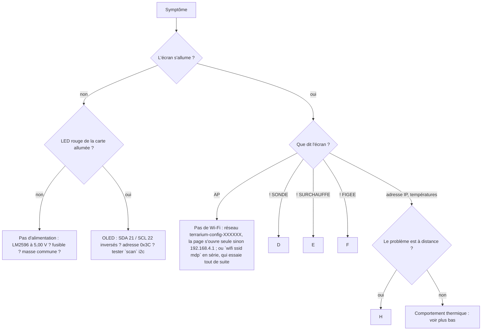

# Dépannage — arbre de décision

Partir du symptôme, suivre les flèches. Les commandes série (`help`, `status`,
`scan`, `sante`, `journal`) se tapent dans le moniteur série de l'IDE Arduino à
115200 bauds, ou dans `arduino-cli monitor`.

## D — Défaut SONDE, ou « aucune sonde détectée »

1. `scan` : combien de sondes ? Si 0, c'est le câblage 1-Wire, pas le logiciel.
2. Résistance **4,7 kΩ entre data et 3,3 V** présente ? Mesurée à 4,7 (calibre 20 k) ?
3. Data sur **GPIO4** du module lui-même — pas une borne de carte d'accueil
   non vérifiée. Mesurer picot ↔ borne à l'ohmmètre : attendu ≈ 0 Ω. (Une carte
   d'accueil a déjà montré 900 kΩ.)
4. Masse commune entre la sonde et la carte ; rouge sur 3,3 V (ou 5 V : tout
   DS18B20 accepte 3 à 5,5 V).
5. Fils Dupont : chacun testé à l'ohmmètre ; les sertissages bon marché font
   des liaisons à haute résistance.
6. Si une seule sonde : la lier aux deux zones en attendant n'est pas possible ;
   la zone sans sonde reste en défaut, c'est voulu.
7. Deux sondes détectées mais la zone reste en défaut : `lier <index> <zone>`
   puis `reset`.

## E — Défaut SURCHAUFFE

- La sonde a lu plus que la coupure maximale. Si la température réelle (IR) est
  normale : sonde mal placée (contre un point très chaud), ou coupure maximale
  trop basse par rapport à la consigne.
- Si la température réelle est vraiment haute : tapis trop puissant pour la
  surface, ou MOSFET resté passant → couper le 12 V, mesurer la grille (doit être
  à 0 V tapis coupé), remplacer le MOSFET.

## F — Défaut FIGEE (sonde bloquée)

La sonde renvoie strictement la même valeur pendant des minutes. Souvent un fil
data intermittent (valeur en cache du capteur) ou une sonde contrefaite. Secouer
doucement le câble en regardant `status` : si la valeur bouge, c'est le fil.

## H — Problèmes à distance (application)

| Ce que montre l'application | Cause probable | Quoi faire |
|---|---|---|
| « non connecté » / erreur d'adresse | URL du broker fausse, pas en `wss://` | Tester la connexion ; adresse `wss://…:8884/mqtt` chez HiveMQ |
| « connexion refusée : identifiants » | mauvais compte broker | Compte de l'application (`appli`), pas celui du socle |
| socle **hors ligne** | socle sans Wi-Fi ou sans MQTT | Écran du socle : « AP » ? `reseau` en série ; `mqtt` réglé ? TLS 8883 ? |
| socle **silencieux** | en ligne mais ne publie plus | Wi-Fi faible (voir Santé du socle), redémarrer |
| « le socle n'a pas répondu » | commande sans réponse | identifiant du socle exact (`terraXXXXXX`) ; préfixe des sujets identique des deux côtés |
| « jeton invalide » | code d'appairage faux | 24 caractères, majuscules ; `jeton` en série |
| « mets à jour l'application » | socle plus récent que l'app | Recharger l'application (bouton « Recharger ») |
| « firmware à mettre à jour » / carte Mise à jour du firmware | socle en retard sur la dernière release | Bouton « Mettre à jour » : le socle télécharge et redémarre ; état `retour arrière` = la nouvelle image a planté, l'ancienne tourne |
| « hote non autorise » à la mise à jour | URL hors des releases du dépôt | Donner une version (`3.4.0`) plutôt qu'une URL ; un fork adapte `config.h` |
| `terraXXXXXX.local` injoignable | réseau sans mDNS, ou cookies bloqués en `http://` | Adresse IP (dans la santé du socle : `ip`) ; autoriser les cookies pour l'adresse locale |

## I — Comportement thermique

- **N'atteint pas la consigne** : alimentation déclarée trop faible (une seule
  zone à la fois), tapis sous-dimensionné, pièce froide. Regarder `demande` :
  100 % en permanence = manque de puissance.
- **Oscille** : lancer l'autotune une fois stable ; sinon bande plus large.
- **Dérive signalée** : couvercle ouvert, pièce froide, tapis vieillissant.
- **Chauffe sans effet** : fil de tapis coupé, bilame ouvert (plaque > 70 °C ?),
  fusible. Avec un INA219, la mesure de courant le dit directement.

## Après un redémarrage inattendu

`sante` affiche la cause (`PANIQUE`, `WATCHDOG`, `CHUTE D'ALIMENTATION`) et le
résumé du coredump ; `test usine` vérifie en une fois écran, sondes, mémoire,
partitions et Wi-Fi. `CHUTE D'ALIMENTATION` = le 5 V s'est effondré : LM2596,
câble, ou tapis qui tire sur le 12 V au démarrage. `PANIQUE` = bug : joindre le
fichier `/api/coredump` à un rapport. Une mise à jour fraîche qui plante est
annulée toute seule : le socle revient à la version d'avant et le dit.
